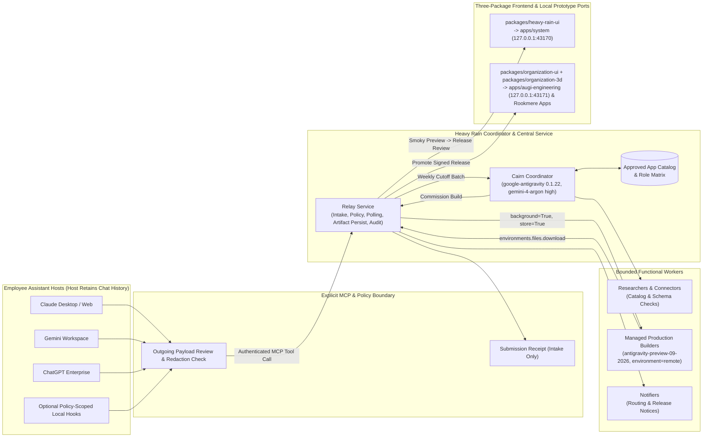

# Heavy Rain system and frontend architecture

**Updated:** 2026-10-25
**Scope:** End-to-end architecture for Heavy Rain, covering explicit MCP evidence capture, organizational access and consent policies, **Relay** coordination, **Cairn** weekly orchestration (`google-antigravity 0.1.22`), managed production **Builders** (`antigravity-preview-09-2026` on the Gemini Interactions API), local `agy` development workforce, three-way UI/3D package separation, bounded jobs, and rollout for **Rookmere Capital** and **AUGI**.

---

## 1. High-level topology and component boundaries

### Intended backend vs local prototype workspaces
- **Intended multiagent backend:** **Relay** ingests live MCP reports, triggers **Cairn** (`google-antigravity 0.1.22`) at the weekly cutoff, and dispatches production **Builders** to the Google-hosted managed Antigravity agent (`antigravity-preview-09-2026`, `environment="remote"`), downloading and persisting verified workspace bundles before human release promotion.
- **Local prototype workspaces in this repository:** `apps/system` (`http://127.0.0.1:43170`) and `apps/augi-engineering` (`http://127.0.0.1:43171`) run locally against the deterministic fixtures in [`demo/rookmere.json`](./demo/rookmere.json) and [`demo/augi.json`](./demo/augi.json). All repository development subagents run via local `agy` (`--model gemini-4-argon-high --effort high`).

---

## 2. Explicit MCP capture and organizational consent policies

Per the Model Context Protocol specification (`2026-07-28`, <https://modelcontextprotocol.io/specification/2026-07-28/architecture>) and connector specifications for Claude (<https://claude.com/docs/connectors/building>), Gemini (<https://support.google.com/gemini/answer/17209137?hl=en-VU>), and ChatGPT (<https://developers.openai.com/plugins/deploy/connect-chatgpt>):

1. **No universal passive scraping:** Host assistants retain full chat history. Heavy Rain receives data only when an employee explicitly invokes `heavyrain_submit_work_report` (or an opt-in policy-scoped local hook) and confirms the exact outgoing payload preview.
2. **Per-organization data scopes and redaction:**
   - **Rookmere Capital (`org_rookmere`):** Enforces `firm_general`, `deal_confidential`, `portfolio_financials`, `lp_summary_commitments`, and restricted `lp_restricted_side_letters` (requiring General Counsel approval of an anonymized clause schema before sandbox ingestion).
   - **AUGI (`org_augi`):** Enforces `sable_parametric_geometry`, `material_cards`, `load_case_targets`, `bom_mass_targets`, `joining_schedules`, and restricted `foundry_proprietary_die_profiles` (keeping native CATIA/NX solid assemblies on workstations and attaching only parametric envelopes and section properties).
3. **Receipts and revocation:** Relay returns an intake `receipt_id` (not completed work) and allows employees to revoke reports within 72 hours prior to weekly cutoff lock.

---

## 3. Weekly evaluation and reuse-first gating (Cairn on `google-antigravity 0.1.22`)

At the weekly cutoff, **Cairn** (running on the local/server coordinator runtime via `google-antigravity==0.1.22`, <https://pypi.org/project/google-antigravity/>, <https://antigravity.google/docs/changelog>) clusters reports and applies a three-way gate:

1. **Direct reuse (`reuse_existing_app`):** Checks `approved_app_catalog` first. When an approved app fits (`app_rm_diligence_tracker` for Rookmere diligence lists; `app_augi_fastener_weld_matrix` for AUGI mixed-material joining) and employees hold the required role permission, Relay routes them directly without an extra approval gate.
2. **Missing-evidence hold (`request_missing_evidence`):** When required schemas or restricted scope sign-offs are absent (`pat_rm_03` LP side letters; `wf_augi_03` megacasting runner porosity), Cairn halts before sandbox allocation and dispatches a targeted evidence request to the domain owner.
3. **Managed sandbox build (`build_in_sandbox`):** Commissioned only when recurrence crosses threshold, existing catalog apps lack the capability (`app_rm_kpi_ingest` lacks ERP trial-balance/FX bridges; `app_augi_bom_mass_ledger` lacks interactive 3D chassis geometry and load-case analytics), and verified schemas are attached.

---

## 4. Production Builders: Google-hosted `antigravity-preview-09-2026` lifecycle and artifact export

Production **Builders** execute in Google-hosted Linux sandboxes via the Gemini Interactions API (<https://ai.google.dev/gemini-api/docs/antigravity-agent>, <https://ai.google.dev/gemini-api/docs/latest-model>, <https://ai.google.dev/gemini-api/docs/agent-environment>, and [`antigravityagentconfig.py#L31`](https://github.com/googleapis/python-genai/blob/cb1408b06c573060f1593023ca320fde9a4fb5f6/google/genai/_gaos/types/interactions/antigravityagentconfig.py#L31)):

1. **Creation (`background=True`, `store=True`):**
   - **Relay** calls `client.interactions.create` with `agent="antigravity-preview-09-2026"`, `environment="remote"`, `background=True`, `store=True`, and `agent_config={"type": "antigravity", "model": "gemini-4-argon", "max_total_tokens": "262144"}`.
   - Setting `"model": "gemini-4-argon"` is mandatory because `antigravity-preview-09-2026` otherwise defaults to `gemini-3.8-flash`.
   - `AntigravityAgentConfig` exposes **only** `type`, `model`, and `max_total_tokens` (int64 string). Passing `thinking_level` or `max_output_tokens` is unsupported (HTTP `400`); reasoning effort is adaptive server-side.
   - Relay immediately persists both `interaction.id` (`interaction_id`) and `interaction.environment_id` (`environment_id`).
2. **Polling and non-success state handling:**
   - While status is `queued` or `in_progress`, Relay polls the interaction and updates the operator console (`apps/system`), where the central preview canvas renders behind a smoky blur while the left navigation, checkpoint pills, `Pause`, and lower worker dock remain sharp.
   - `completed` is the **only** success state that unlocks artifact verification and preview clearance.
   - Relay explicitly handles `requires_action` (awaiting tool/policy confirmation), `incomplete` (stopped early due to `max_total_tokens` cap or timeout, preserving `environment_id` for inspection or continuation), `failed`, and `cancelled`.
3. **Artifact download and durable persistence (`v1beta/environments`):**
   - Upon `completed`, Relay exports the workspace archive via `client.environments.files.download(environment=env_id, path="workspace")` (or individual returned file paths) or `GET https://generativelanguage.googleapis.com/v1beta/environments/{env_id}/files?alt=media` (never the deprecated `/files/environment-{id}:download` route).
   - Hosted environments (4 vCPU, 16 GB RAM) snapshot and stop after **15 minutes** of inactivity, remain resumable in `Offline` state for **7 days**, and are deleted after 7 days. Relay persists verified artifact bundles into durable organization storage immediately and gates promotion to `deployed_approved` on human release review.
4. **Sandbox security:** Outbound network access inside the remote environment is constrained by an explicit network **allowlist**, and any external credentials are injected at request time by Google's egress proxy via **managed credential IDs** rather than exposed inside the container.

---

## 5. Three-package frontend baseline and operator layout (`03-system-c.png`)

All frontend workspaces use **Vite (`^8.3.5`) + React (`^19.0.0`) + TypeScript (`^7.0.2`) + Three.js (`^0.186.1`)** with zero `shadcn/ui` dependencies:

| Workspace | Package Name / Port | Responsibility & Boundary Rules |
| --- | --- | --- |
| `packages/heavy-rain-ui` | `@heavy-rain/system-ui` | Operator console components for `apps/system` (`03-system-c.png` layout): pale ash and rain-dark topographic surfaces, softly faded inactive left vertical navigation with active dark tick and click feedback, large central artifact stage, smoky blurred build preview, sharp checkpoint/pause controls, lower worker dock, and `02-wordmark.png` (`heavy-rain-mark.svg`) brand identity. |
| `packages/organization-ui` | `@heavy-rain/organization-ui` | Shared baseline for organization applications: organization themes (`rookmere-ash-ledger`, `augi-graphite-atelier`), identity/permission headers, audit/freshness notices, inline model-limitation disclosures, and financial/engineering tables. |
| `packages/organization-3d` | `@heavy-rain/organization-3d` | Reusable 3D toolkit for WebGL renderer setup, camera/orbit/pan/zoom/tilt navigation, part selection, spatial measurement, and deformation/assembly animation—kept distinct from domain models, `packages/organization-ui`, and `packages/heavy-rain-ui`. |
| `apps/system` | `http://127.0.0.1:43170` (`--strictPort`) | Heavy Rain operator console (`npm run dev:system`). |
| `apps/augi-engineering` | `http://127.0.0.1:43171` (`--strictPort`) | AUGI Sable 3D Chassis Comparator (`npm run dev:augi`). Never imports `@heavy-rain/system-ui` or `packages/heavy-rain-ui` (enforced by `npm run check:boundaries`). |

---

## 6. Bounded jobs, token budgets, auditability, and four-step rollout

- **Coordinator vs Builder token ceilings:** **Cairn** (`google-antigravity 0.1.22`) operates within Gemini 4 Argon's `1,048,576` shared token ceiling (`input + thinking + output`, `65,536` sync output cap, Long Decode via `GeminiModelOptions.max_output_tokens`, handling thinking-only hops without premature stream termination). Production **Builders** (`antigravity-preview-09-2026`) bound total interaction spend via `AntigravityAgentConfig.max_total_tokens`. Unchanged failing calls are never blindly retried.
- **Audit and notifications:** Relay logs every receipt, cluster decision, interaction ID, environment ID, artifact SHA-256 digest, and release sign-off, dispatching **Notifiers** only on direct reuse links, missing-evidence requests, and verified releases.
- **Four-step rollout:** `1. Register MCP connector & roles -> 2. Seed approved app catalog -> 3. Run weekly cutoff in review mode -> 4. Enable managed sandbox Builders & portal promotion`.
