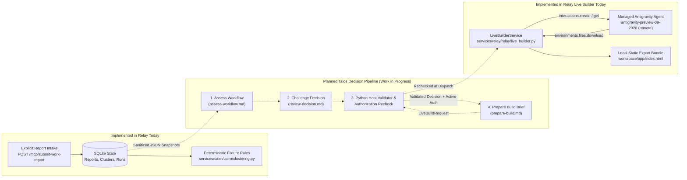

# Talos workflow evaluation and decision system design

**Status:** Work in progress — proposed architecture and operational specification for engineers implementing Talos. None of the new Talos stages, schemas, or prompts described here are active in the current runtime.

## 1. Objective, naming boundary, and non-goals

Heavy Rain helps organizations turn recurring, explicitly reported assistant tasks into governed routing decisions or reviewable application prototypes. Within Heavy Rain:

- **Relay** (`services/relay`) is the intake, policy, persistence, and builder coordination backend.
- **Talos** is the planned workflow discovery, recurrence evaluation, and decision system. Talos replaces **Cairn** as the product name of the decision layer.
- **Code compatibility:** Existing Python packages (`services/cairn`), classes (`CairnOrchestrator`, `CairnCoordinatorConfig`), health fields (`cairn`), fixtures, and the `/api/v1/orgs/{org_id}/batches/review-with-cairn` route keep their `cairn`/`Cairn` identifiers so current tests and local workflows continue to run without churn.

**Objective:** Evaluate explicitly submitted employee workflow reports against an organization's `approved_app_catalog`, role matrix, and data-scope policies; separate genuinely recurring work from duplicate mentions of a single event; and produce source-cited recommendations (`reuse_existing_app`, `build_in_sandbox`, `request_missing_evidence`, `queued_next_cycle`, or the proposed `do_not_build`) before spending remote sandbox builder tokens.

**Non-goals:**
- Passive scraping of employee chat sessions or ambient desktop activity.
- Treating a model recommendation or review flag as execution authority, policy enforcement, or human approval.
- Inventing or inferring time-savings estimates (`weekly_hours_saved`), headcount reductions, or financial ROI figures.
- Deploying generated applications directly to production or connecting sandbox builds to live external corporate backends (such as Outlook, Affinity, Granola, or ERP databases).

## 2. Current implementation boundaries vs. planned Talos pipeline

### What runs today
1. **Live builder (`services/relay/relay/live_builder.py`):** Uses the Google Gen AI Python SDK (`google-genai`) to call `client.interactions.create` with `agent="antigravity-preview-09-2026"`, `environment="remote"`, `background=True`, and `store=True`. Relay streams and polls interaction progress via `interactions.get`, supports `interactions.cancel`, lists and downloads sandbox files via `environments.files.list` and `environments.files.download`, stores run and event state in SQLite, and serves a self-contained static bundle (`scaffold.css`, `index.html`, `NOTES.md`, `preview.svg`, `card.json`) locally for human review. An optional narrator (`services/relay/relay/narrator.py`) calls `models.generate_content` (defaulting to `gemini-3.8-flash`) to condense step updates and falls back to the original step text on failure.
2. **Observed local server state (recorded 2026-10-25):** In `services/relay/relay/live_builder.py`, `LiveBuilderSettings` defaults to `model="gemini-3.8-flash"` and `self.settings.max_total_tokens` governs provider token spend (`LiveBuildRequest` has no per-request token-budget field). In the local server observation recorded on October 25, 2026 (`http://127.0.0.1:43180`), Relay ran with `liveBuilderEnabled: true`, `liveBuilderModel: "gemini-4-argon"`, and `liveModelReviewEnabled: false`, with SQLite recording one completed `gemini-4-argon` build run with a downloaded artifact and two completed `gemini-3.8-flash` build runs with downloaded artifacts. Those records confirm provider interaction completion and local artifact extraction; they do not establish independent functional verification of the generated apps or production readiness.
3. **Deterministic coordinator and optional review (`services/cairn`):** Batch evaluation runs deterministic rules in `services/cairn/cairn/clustering.py` (`coordinatorExecution: "deterministic_fixture_rules"`). An optional single-call read-only review in `services/cairn/cairn/live_review.py` targets `google-antigravity==0.1.22` with `ARGON_MODEL_NAME` (`gemini-4-argon`, `ThinkingLevel.HIGH`, `MAX_REVIEW_TOKENS = 16_384`, `MAX_REVIEW_OUTPUT_TOKENS = 4_096`, `REVIEW_TIMEOUT_SECONDS = 90`), parsing the JSON response into a typed model class, and was disabled in the 2026-10-25 local server observation.
4. **Current demo authentication boundary:** The existing operator UI (`apps/system`) and Relay API routes switch organizations (`rookmere`, `augi`, `meridian`) and personas through unauthenticated demo selectors backed by local fixtures and SQLite. Production multi-tenant authentication and server-enforced session RBAC are not implemented in the prototype.

### Build modes (`flash` vs. `argon`) and static export boundary
Per-request `build_mode` (`Literal["flash", "argon"] | None`) is implemented in `services/relay/relay/models.py` and `services/relay/relay/live_builder.py`: an explicit `"flash"` or `"argon"` value routes the build to `gemini-3.8-flash` or `gemini-4-argon` with distinct builder prompts, while `None` falls back to `LiveBuilderSettings.model`. The Talos-to-builder handoff (`BuilderConstraintsSnapshot`, `AuthorizationSnapshot.authorized_build_mode`, and `PrepareBuildOutput`) remains proposed:
- **Flash (`"flash"`, `gemini-3.8-flash`):** Separate builder prompt requests a quick, low-fidelity interactive scaffold (`max_workspace_bytes: 150000` target) to inspect workflow structure and layout.
- **Argon (`"argon"`, `gemini-4-argon`):** Separate builder prompt requests a complete, high-fidelity, self-contained application (`max_workspace_bytes: 1048576` target) with working client-side interactions, realistic domain sample data standing in for unconnected external systems, and local browser persistence (`localStorage` or `IndexedDB`) where appropriate.
- **Prompt targets vs. host enforcement:** Mode fidelity descriptions and workspace byte ceilings (`150,000` bytes for `"flash"`, `1,048,576` bytes for `"argon"`) are prompt targets rather than guaranteed runtime outcomes; current runtime validation does not enforce mode-specific byte caps, so future Talos host validation must enforce `max_workspace_bytes` on downloaded artifacts if claimed.
- **Shared export and network rules:** Both modes emit the same five required static deliverables (`scaffold.css`, `index.html`, `NOTES.md`, `preview.svg`, `card.json` conforming to `LiveBuildCard`), forbid external network requests (`fetch`, `XMLHttpRequest`, WebSockets, or external CDNs), and remain sandbox builds requiring human release review rather than live backend deployments.

### Prompt composition protocol
Models invoked by Talos have no callable tools, no filesystem access, and no ability to read repository paths at runtime. Host code must follow one unified composition protocol using the existing placeholder inventory (without adding template placeholders for instruction documents):
1. **Authoritative contract context + single-pass stage rendering:** For every call, the Python host loads `__grounding/talos/contracts.md` as authoritative contract context and renders the selected stage prompt (`assess-workflow.md`, `review-decision.md`, or `prepare-build.md`) by substituting only that stage prompt's declared `{{...}}` placeholders with UTF-8 JSON snapshots in a single regex pass.
2. **Direct stage calls:** The host supplies the loaded `contracts.md` content together with the rendered stage prompt, then parses and validates the model response against the corresponding proposed host Pydantic model (`WorkflowAssessmentOutput`, `DecisionReviewOutput`, or `PrepareBuildOutput` with `extra="forbid"`), following the host-side model parsing pattern in `services/cairn/cairn/live_review.py` rather than relying on an unverified SDK `response_schema` parameter.
3. **Coordinator envelope calls (`coordinator.md`):** When running the stage envelope coordinator, the host renders `coordinator.md` with `{{talos_policy_json}}` (`TalosPolicySnapshot`) and `{{task_input_json}}` (`TalosTaskInputSnapshot`), and also renders the target stage prompt for `task_input.stage` by mapping `task_input.stage_payload` fields to that stage's placeholders (`stage_payload.evidence_snapshot` -> `{{evidence_snapshot_json}}`, `stage_payload.catalog_snapshot` -> `{{catalog_snapshot_json}}`, `stage_payload.assessment` -> `{{assessment_json}}`, `stage_payload.proposed_decision` -> `{{proposed_decision_json}}`, `stage_payload.validated_decision` -> `{{validated_decision_json}}`, `stage_payload.authorization_snapshot` -> `{{authorization_snapshot_json}}`, `stage_payload.builder_constraints` -> `{{builder_constraints_json}}`) and `talos_policy` -> `{{policy_snapshot_json}}`. The host passes `contracts.md`, the rendered `coordinator.md` outer envelope instructions, and the rendered stage instructions (explicitly scoped to govern only the nested `CoordinatorEnvelopeOutput.result` payload), and validates the output against the proposed `CoordinatorEnvelopeOutput` model for that stage. The model is never asked to read files or infer missing stage rules or schemas.

## 3. Consented intake, provenance, and recurrence deduplication

Talos evaluates only reports explicitly submitted through `heavyrain_submit_work_report` after the employee inspects the outgoing payload preview.

- **Source provenance:** Every assessment claim must cite concrete `report_id`, `employee_id`, `role_id`, and `attachment_id` values present in `{{evidence_snapshot_json}}`. Host code strips raw file bodies and credentials before building the snapshot.
- **Withdrawn and deleted reports:** Employees may withdraw reports (`status: "withdrawn"`) and administrators may scrub records (`status: "deleted_tombstone"`). Host code must exclude non-active reports or mark their status explicitly; `assess-workflow.md` places every non-active `report_id` into `excluded_report_ids` and never counts them toward recurrence or schema coverage.
- **Deduplicating occurrences vs. repeated mentions:**
  - `EvidenceSnapshot.reports[]` supplies explicit provenance fields: `session_id` (nullable), `source_event_id` (nullable identifier for a specific close run, deal screen, or meeting event), `task_window_start_iso` and `task_window_end_iso` (nullable bounded task window), and `collaborator_employee_ids`. Two `null` values never match each other.
  - **Never merge solely on `session_id` or attachment `sha256`:** A single assistant `session_id` can contain multiple distinct tasks, and a reused attachment `sha256` can represent a shared template or lack event/time provenance. Merge active reports into one occurrence (`independent_occurrence_count` increases by `1`) only when:
    1. They share the same non-null `source_event_id` (`deduplication_basis: "explicit_event_id"`), even across different employees; or
    2. They have no conflicting non-null `source_event_id` values and share a matching non-null bounded task window (`task_window_start_iso` and `task_window_end_iso`) together with corroborating same-task retry or payload evidence (`"same_session_retry"` when retrying the same task within that bounded window, or `"same_window_and_payload"` when submitting the same task payload/event within that window).
    All participating employees on merged reports are recorded in that occurrence's `contributor_employee_ids`; different employees referencing one shared event count once.
  - **Distinct occurrences vs. reused hashes:** Count active reports as separate independent occurrences (`"distinct_verified_occurrence"`) only when distinct non-null `source_event_id` values or non-overlapping bounded task windows establish separate executions. Identical attachment `sha256` digests on reusable mapping rules or schema templates across distinct verified `source_event_id` values or non-overlapping task windows do not collapse those separate executions. Never infer independent recurrences merely from similar `task_summary` text, different `submitted_at_iso` timestamps, or reused hashes.
  - **Ambiguous recurrence (`ambiguous_report_ids`):** Reused attachment `sha256` digests, shared `session_id` values, or similar summaries *without* non-null `source_event_id` or bounded `task_window_*` provenance prove neither duplicate submissions nor independent occurrences. If such an unresolved group establishes that at least one actual task execution occurred, record **one** verified occurrence in `deduplicated_occurrences` (`primary_report_id` only, with `duplicate_report_ids: []`) and place the remaining unverified reports in `ambiguous_report_ids`; if the group does not establish even one verified execution, place all unresolved active reports in `ambiguous_report_ids`. If verified `independent_occurrence_count` falls below threshold because of unresolved reports, recommend `request_missing_evidence`.
  - **Configurable employee threshold:** `TalosPolicySnapshot` specifies both `min_independent_occurrences_for_build` and `min_distinct_employees_for_build`. When an organization sets `min_distinct_employees_for_build: 1`, a single specialist repeating a verified workflow across multiple independent occurrences qualifies for `build_in_sandbox` if all other gates pass.

## 4. Catalog reuse, tri-state permissions, trusted clearances, and counterevidence

Before recommending a sandbox build, Talos compares each task cluster against `{{catalog_snapshot_json}}` and `{{policy_snapshot_json}}`:

1. **Capability and release status fit:** Only catalog apps with `release_status == "catalog_approved"` qualify for direct routing (`reuse_existing_app`).
2. **Tri-state capability, role, and data-scope checks:** `catalog_fit` records `capability_fit_status`, `role_permissions_status`, and `data_scopes_status` as `"satisfied" | "unsatisfied" | "unknown"`, and `restricted_clearance_status` as `"not_required" | "cleared" | "missing_clearance" | "unknown"`.
   - When `catalog_status == "available"` and no existing catalog app matches the workflow (`closest_app_id: null`), `capability_fit_status` is `"unsatisfied"` (`semantic_fit_verdict: "insufficient_capability"`), establishing a known capability gap rather than `"unknown"`. For `build_in_sandbox` candidates, `role_permissions_status` and `data_scopes_status` evaluate whether the target cluster's participating roles are permitted to access the cluster's required data scopes under `TalosPolicySnapshot.roles`.
   - `"unknown"` is strictly separate from `"unsatisfied"` and means required capability metadata (such as `catalog_status == "unavailable"`), role definitions, or data-scope definitions are absent from the supplied snapshots. Any `"unknown"` status blocks both `reuse_existing_app` and `build_in_sandbox` and requires `request_missing_evidence`.
3. **Trusted explicit scope clearances:** Restricted data-scope clearance is read from `TalosPolicySnapshot.scope_clearances` for the target cluster (and `AuthorizationSnapshot.restricted_scope_cleared` at build handoff, which the host computes as `true` when all restricted scopes required by the target cluster are cleared or when the target cluster requires no restricted scopes), never inferred by the model from attachment filenames.
4. **Counterevidence (`counter_evidence`):** Every `ClusterAssessmentRecord` requires the `counter_evidence` array field (`string[]`) to surface concrete reasons against building or routing (such as partial catalog overlap, `blocked_macro` attachments, missing restricted clearances, or conflicting formulas across reports). When the supplied snapshots contain no counterevidence, the model must return `[]` rather than inventing artificial objections.

## 5. Dispositions and explicit judgment criteria

### Proposed Talos gates using existing disposition names (`services/cairn/cairn/clustering.py` and `services/relay/relay/models.py`)
Only the four disposition enum values below already exist in `services/cairn/cairn/clustering.py` and `services/relay/relay/models.py` (where today's runtime assigns them via deterministic fixture rules); the tri-state permission, recurrence, and clearance gate criteria below are proposed Talos rules:
1. `reuse_existing_app`: An approved catalog app (`release_status == "catalog_approved"`) satisfies the workflow (`capability_fit_status == "satisfied"`, `role_permissions_status == "satisfied"`, `data_scopes_status == "satisfied"`).
2. `build_in_sandbox`: Verified capability gap (`semantic_fit_verdict == "insufficient_capability"`, `capability_fit_status == "unsatisfied"`) across recurring reports in the target cluster meeting `min_independent_occurrences_for_build` and `min_distinct_employees_for_build`, with `role_permissions_status == "satisfied"` and `data_scopes_status == "satisfied"` for the target cluster's participating roles and required scopes, approved schema attachments, `restricted_clearance_status` in `{"not_required", "cleared"}`, and `schema_gaps == []`.
3. `request_missing_evidence`: Plausible workflow where recurrence provenance is ambiguous, required attachment schemas are missing or conflicting, or capability/role/scope/clearance status is `"unknown"` or `"missing_clearance"`.
4. `queued_next_cycle`: Valid workflow with no blocking policy or permission conflict that is below `min_independent_occurrences_for_build` or `min_distinct_employees_for_build` (and has no unresolved ambiguity), or depends on another workbench in flight.

### Proposed fifth disposition (requires migration)
5. `do_not_build` *(proposed)*: The reported workflow violates organizational policy, requires prohibited live external write integrations, or is an explicitly confirmed one-off task unsuitable for an internal app.

**Migration requirement:** Today's runtime supports only the four implemented dispositions (`reuse_existing_app`, `build_in_sandbox`, `request_missing_evidence`, `queued_next_cycle`). Adopting `do_not_build` requires a schema migration across `ClusterDisposition` in `services/relay/relay/models.py` and `services/cairn/cairn/clustering.py`, `ReviewDecision` in `services/cairn/cairn/live_review.py`, Relay SQLite tables, and frontend badges.

**No inferred time savings or ROI:** `LiveBuildWorkflow.weekly_hours_saved` must remain `null` unless a verified measurement is explicitly supplied by the host, and prose fields must never invent hours saved or financial ROI.

## 6. Current vs. proposed enforcement, authorization expiry, and shadow mode

### Prompt formatting vs. host security enforcement
- **Formatting only:** XML tags (`<evidence_snapshot>`) and single-pass placeholder replacement (`PLACEHOLDER_PATTERN.sub`) organize prompt inputs and prevent recursive `{{...}}` expansion inside untrusted strings, but they do **not** enforce access control.
- **Model flags are recommendations:** Every Talos output carries `recommendation_only: true`. A model verdict of `approved_for_host_validation` or `ready_for_live_builder` is an unprivileged recommendation.
- **Host Python enforcement (proposed for Talos):** Before saving any decision or calling `LiveBuilderService.accept`, Python host code must validate proposed Pydantic schemas (`extra="forbid"`), verify partition math over active and excluded reports for the target cluster in `evidence_snapshot.clusters[]`, confirm every cited ID belongs to the target `org_id` and `cluster_id`, and enforce role and data-scope permissions for both the target cluster's participating roles and the `requested_by` persona's role against trusted `TalosPolicySnapshot` state.

### Authorization binding, expiry check, token ceiling derivation, and preserved autonomy
To prevent stale or mismatched build dispatches, the proposed `AuthorizationSnapshot` binds operator approval to:
- `org_id`, `batch_id`, and `cluster_id` (matching a cluster in `evidence_snapshot.clusters[]`, with all report and `data_scope` checks scoped strictly to that target cluster rather than across unrelated clusters in the batch)
- `bound_evidence_snapshot_sha256`, `bound_catalog_snapshot_sha256`, and `bound_policy_version`
- `approved_data_scopes` and `restricted_scope_cleared` (where `restricted_scope_cleared` is host-computed `true` when all restricted scopes required by the target cluster are cleared in `TalosPolicySnapshot.scope_clearances` **or** when the target cluster requires no restricted scopes)
- A host-generated `idempotency_key` (6–128 chars) and trusted `requested_by` object (`persona_id`, `name`, `role`), which `prepare-build.md` must copy verbatim without inventing identities; the host must also verify against `TalosPolicySnapshot.roles` that the `requested_by` role and participating cluster roles are permitted for every data scope required by the target cluster (blocking the build if the requester's or cluster roles' scope permission is denied or missing)
- `authorized_build_mode` (`"flash"` or `"argon"`) and `authorized_max_total_tokens`. Because `LiveBuildRequest` has no per-request token-budget field and `LiveBuilderService` uses `self.settings.max_total_tokens` (`LiveBuilderSettings` in `services/relay/relay/live_builder.py`), the host derives `BuilderConstraintsSnapshot.max_total_tokens` from the effective `LiveBuilderService` settings (and mode/model mapping), requires `builder_constraints.max_total_tokens <= authorization_snapshot.authorized_max_total_tokens`, and rechecks that same effective `self.settings.max_total_tokens` value immediately before calling `LiveBuilderService.accept`
- Explicit UTC timestamps (`evaluated_at_iso`, `authorized_at_iso`, `authorization_expires_at_iso`) and host-computed booleans (`build_authorized`, `is_expired`, `is_revoked`, `can_authorize_sandbox_build`, and `authorization_status`)

Both `prepare-build.md` and the Python host check that `authorization_status == "valid"`, `build_authorized == true`, `is_expired == false`, `is_revoked == false`, and `evaluated_at_iso < authorization_expires_at_iso`. The Python host must re-evaluate expiry, target-cluster scope permissions, and `self.settings.max_total_tokens <= authorization_snapshot.authorized_max_total_tokens` against current server state and the server clock immediately before calling `LiveBuilderService.accept`. When a valid, non-expired authorization is present and all gates pass, `prepare-build.md` emits `status: "ready_for_live_builder"` directly without introducing a redundant confirmation gate. Human release review remains a separate gate after the sandbox build completes.

### Proposed provider timeout guard (`acceptance_uncertain`)
In the proposed Talos handoff, if `interactions.create` times out or loses its connection before Relay records an `interaction_id`, Relay marks the idempotency record `provider_acceptance_state: "acceptance_uncertain"`. Both `prepare-build.md` and the host dispatch gate block any new build while `provider_acceptance_state` is `"accepted"` or `"acceptance_uncertain"` so retries do not spawn duplicate remote sandbox containers.

### Proposed shadow mode and rate-limit governance
During rollout, Talos is planned to run in shadow mode (`shadow_state: "shadow_review_pending"`) alongside deterministic rules so operators can compare outputs without mutating cluster `actionState` or sending notifications. While `CairnCoordinatorConfig` and `CairnRateLimitGovernor` already exist as helper classes in `services/cairn/cairn/config.py`, wiring them into the multi-stage Talos pipeline (along with payload fingerprinting for unchanged failing retries and thought-token stripping) remains a planned design and is not active in the current runtime.

## 7. Staged implementation plan (proposed)

1. **Stage 1 — Schema and contract additions:** Add `do_not_build`, `shadow_review_pending`, and `acceptance_uncertain` state tracking to Pydantic models and SQLite tables.
2. **Stage 2 — Read-only shadow assessment and review:** Run `assess-workflow.md` and `review-decision.md` on `google-antigravity==0.1.22` with Python host partition and referential validators.
3. **Stage 3 — Authorized build handoff:** Wire `prepare-build.md` and host dispatch rechecks into `LiveBuilderService.accept` with explicit `build_mode` (`"flash"` or `"argon"`).
4. **Stage 4 — Operator shadow comparison UI:** Surface side-by-side diffs in `apps/system` (`http://127.0.0.1:43170`).
