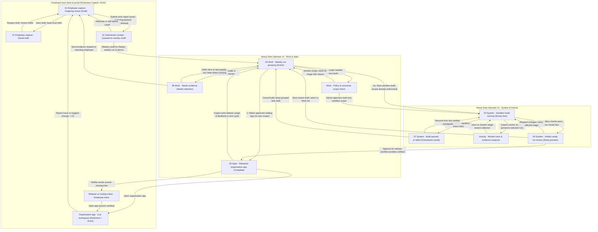
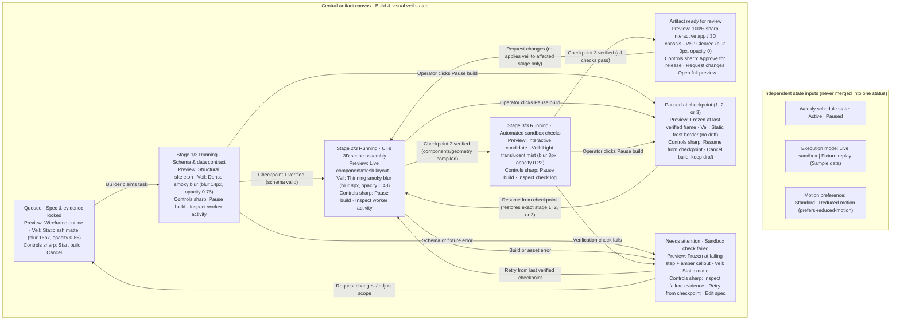

# Heavy Rain end-to-end UX journey and information architecture

**Grounding date:** 2026-10-25.
**Editable Mermaid sources:** [`full-flow.mmd`](./full-flow.mmd) · [`build-states.mmd`](./build-states.mmd) · [`augi-flow.mmd`](./augi-flow.mmd)
**4K Nano Banana Pro overview prompt:** [`__grounding/inspiration/ux/full-flow.prompt.txt`](../inspiration/ux/full-flow.prompt.txt)
**Builder handoff briefs:** [`system-ui-handoff.md`](./system-ui-handoff.md) · [`augi-ui-handoff.md`](./augi-ui-handoff.md)

---

## 1. Proposed experience and epistemic status

An employee working in Claude, Gemini, or ChatGPT captures a recurring task through an authenticated custom MCP tool, inspects the exact outgoing work report and approved sample files before submission, and receives a receipt queued for the organization's weekly cutoff. At the weekly cutoff, **Relay** (central intake and coordination service) and **Cairn** (Argon orchestrator) group recurring tasks, check the organization's approved application catalog first, and present three explicit paths in the Heavy Rain operator interface: **route directly to an existing approved app**, **request missing evidence from the sender**, or **commission a sandbox application build**. During a sandbox build, **Builders** (Argon-powered Antigravity agents in sandboxes) assemble and verify the candidate app behind a state-driven smoky blur while checkpoints, pause/resume controls, and worker traces remain sharp. When automated sandbox checks pass, the smoky veil clears to reveal the interactive artifact—such as **Rookmere Capital's** portfolio variance report or **AUGI's** interactive 3D **AUGI Sable** chassis engineering study—for release review, access-checked notification, live organization use, and post-release feedback.

- **Known (from owner decisions in [`product.md`](../product.md)):**
  - Working names are fixed: **Cairn** (Argon orchestrator), **Relay** (central service), and functional workers (**Builders**, **Connectors**, **Researchers**, **Notifiers**).
  - Full conversation history stays in the employee's host client (`Claude`, `Gemini`, `ChatGPT`); only explicitly reviewed work reports and approved local evidence are transmitted.
  - Operator main navigation is exactly **`System`**, **`Work`**, **`Apps`**, **`Activity`**, anchored on the center-heavy, tactile left-rail, topographic layout of [`09-tactical-gear-landing-page-anorent.png`](../inspiration/references/dribbble/09-tactical-gear-landing-page-anorent.png).
  - Two separate component libraries: `packages/heavy-rain-ui` (operator system UI) and `packages/organization-ui` (organization apps with distinct Rookmere Capital and AUGI themes; never imports `packages/heavy-rain-ui`).
  - Demo replay must be disclosed once at the workspace/run scope and must never execute real production writes or messages.
- **Proposed (UX recommendations in this flow):**
  - Separate independent statuses (weekly schedule, current weekly run, sandbox build checkpoint, app release state, and sample-data freshness) so pausing a weekly schedule never claims to cancel an in-flight sandbox build, and pausing a build freezes at the last verified checkpoint (`1. Schema check`, `2. UI assembly`, `3. Verification`).
  - Route matched catalog apps (`Diligence request tracker` for Rookmere; `Supplier material certificate lookup` for AUGI) without adding redundant operator approval gates when no new data or permission scope is needed.
  - Isolate missing-evidence tasks (`LP side-letter obligations`) into a recoverable request loop so unblocked tasks in the same weekly run proceed immediately.
- **Open assumptions (non-blocking; defaulted for prototype build):**
  - *Assumption 1:* In the demo UI, switching between `Rookmere Capital` and `AUGI` in the top context bar preserves each organization's in-memory run/build state during the browser session so evaluators can compare both organizations without losing progress.
  - *Assumption 2:* Employee outgoing-review capture and release notifications are inspectable inside the prototype via a lightweight drawer/preview linked from `Work` and `Apps`, allowing end-to-end walkthrough verification without requiring a separate live MCP host window.

---

## 2. Proposed information architecture (IA)

Heavy Rain separates three role-scoped surfaces across two isolated UI packages:

| Surface & package | Primary actor | Navigation & entry points | Core responsibilities |
| --- | --- | --- | --- |
| **1. Employee capture & portal** *(Lightweight host MCP review sheet + notification view)* | Employee (Rookmere analyst, compliance officer, or AUGI structures engineer) | Invoked from host assistant (`Submit work report to Relay`) or from a release/routing notification link | Inspect exact outgoing task description and approved attachments before sending; save/withdraw draft before weekly cutoff; open access-checked link to matched or newly released organization app; submit follow-up feedback. |
| **2. Heavy Rain Operator UI (`apps/system` via `packages/heavy-rain-ui`)** | Operator / Platform lead (with Finance or Legal admin handoffs when scope changes) | Persistent left vertical rail: **`System`**, **`Work`**, **`Apps`**, **`Activity`**, scoped by top-bar **Organization** (`Rookmere Capital` \| `AUGI`) and **Weekly run** selector | **`System`:** Center-stage sandbox build (smoky blur → sharp interactive artifact), checkpoint rail, pause/resume, release review. **`Work`:** Weekly recurrence clusters, outgoing report inspection, reuse/build/evidence routing. **`Apps`:** Released organization catalog, scope status, launch organization app, post-release feedback. **`Activity`:** Chronological worker trace (`Cairn`, `Relay`, `Builder`, `Connector`, `Researcher`, `Notifier`), evidence links, and concise decision summaries (no hidden chain-of-thought). |
| **3. Organization Applications (`apps/augi-engineering` & Rookmere views via `packages/organization-ui`)** | Organization employees & reviewing operators | Launched via `Open organization app` from `System` or `Apps`, or direct link from employee notification | **Rookmere theme:** `Portfolio variance report` (4 detailed sample portfolio companies across EUR 480m + EUR 720m funds) and `Diligence request tracker`. **AUGI theme:** `AUGI Sable chassis study` (interactive Three.js/R3F 3D concept chassis viewer with orbit/pan/zoom, presets, wheelbase/track/gauge/material controls, torsion/bending approximations, exploded view, deformation animation, and Baseline A vs Candidate B comparison). |

---

## 3. End-to-end wireflow and separated detail diagrams

To keep diagrams legible, the flow is split into three editable Mermaid diagrams:
1. **End-to-end overview (`full-flow.mmd`):** Covers employee capture (`01`), weekly triage (`02`), smoky sandbox build (`03`), ready review (`04`), released organization app (`05`), missing-evidence branch (`06`), and build pause/failure recovery (`07`).
2. **Sandbox build & smoky blur state machine (`build-states.mmd`):** Details the exact visual veil opacity/blur levels, checkpoint persistence, and reduced-motion behavior.
3. **AUGI Sable 3D chassis study flow (`augi-flow.mmd`):** Details camera presets, parametric editing, load cases, exploded/deformation animation, and side-by-side configuration comparison.

### A. End-to-end journey (`full-flow.mmd`)

### B. Sandbox build & smoky blur state semantics (`build-states.mmd`)

---

## 4. Consequential steps and actor handoffs

| Person and entry condition | What they see and do | What the system does and saves | Next step, exit, or recovery |
| --- | --- | --- | --- |
| **1. Employee · Capturing a repeated task** in Claude, Gemini, or ChatGPT (`01 Draft`) | Opens outgoing work report sheet. Reviews exact task summary, selects approved sample attachment (`Q3_variance_template.xlsx` or `Sable_load_cases.csv`), sees notice that full chat history stays in host client. Clicks `Submit work report` or `Save draft`. | Validates attachment type against org policy. On submit, **Relay** stores an immutable report snapshot and returns a timestamped **Submission receipt** (`Queued for Sun 18:00 UTC cutoff`). Does not claim the app is built. | Employee can `Withdraw or edit before cutoff` to reopen the draft, or close the sheet and continue normal work. |
| **2. System (`Relay` + `Cairn`) · Weekly cutoff** (`02 Work · Grouping`) | Operator opens `Work` (or clicks `Replay weekly run` in demo). Sees grouped recurrence clusters with report counts, roles, and catalog match results. | **Researchers** and **Cairn** group reports by recurring task intent and compare against the organization's approved catalog and data-scope baseline. | Three explicit branches per cluster: **Reuse**, **Need evidence**, or **Sandbox build**. |
| **3a. Operator · Catalog match (`Reuse`)** on `Diligence request tracker` (Rookmere) or `Supplier material certificate lookup` (AUGI) | Sees badge `Existing app match · No new scope required` and clicks `Route to existing app` (or allows automatic routing when pre-authorized). | **Notifier** sends an access-checked deep link to the reporting employees; records routing outcome in `Activity` and `Apps`. No duplicate app is built. | Reporting employees open the existing approved app directly; if they lacked role access, they see an access request route to the app owner. |
| **3b. Operator · Missing evidence (`Need evidence`)** on `LP side-letter obligations` (`06 Needs attention`) | Sees what is missing (`Needs 1 redacted sample obligation schedule from Legal`) and clicks `Send evidence request`. | Marks only the `LP side-letter obligations` cluster as `Waiting on sample file` with a direct link back to the reporting employee (`01`). Other clusters in the weekly run continue unblocked. | Employee attaches the redacted sample schedule and resubmits, or operator clicks `Defer to next weekly run`. |
| **3c. Operator · Commissioning a sandbox build (`Build`)** on `Portfolio variance report` or `AUGI Sable chassis study` (`03 Running`) | Clicks `Start sandbox build` (if scope is already authorized) or requests Finance/Engineering admin sign-off on read-only connector scope first. Transitions to `System`. | **Cairn** assigns a sandbox **Builder** (`agy` in sandbox). Central preview renders behind a smoky blur whose density decreases across 3 verified checkpoints (`1. Schema check`, `2. UI assembly`, `3. Verification`). | Operator can watch progress, click `Inspect worker activity` to view tool results in `Activity`, `Pause build`, or leave and return without starting a duplicate build. |
| **4. Operator · Pausing, failing, or cancelling a build** (`07 Paused / Failed`) | Clicks `Pause build` (or sees an amber/coral banner when a sandbox check fails, e.g., missing GBP-to-EUR column mapping). | Freezes the sandbox worker at the last verified checkpoint (`Checkpoint 1 saved`), stops smoke drift, and records the exact failure or pause reason. | Click `Resume from checkpoint` / `Retry from checkpoint` (idempotent; skips already passed stages) or `Cancel build; keep draft` (returns task group to `Work` with evidence intact). |
| **5. Operator · Artifact ready & release review** (`04 Ready for review`) | Smoky blur clears completely (`blur 0px`). Operator interacts with the live candidate in the center stage (or clicks `Open organization app` for full-screen inspection), reviews verification checks (`0 production writes`), and clicks `Approve for release` or `Request changes`. | On `Approve for release`, promotes the verified artifact to the organization catalog in `packages/organization-ui` (with Rookmere or AUGI theme) and triggers **Notifier**. On `Request changes`, saves operator notes and re-runs only the affected build stage. | Released app appears in `Apps` (`05 Complete`); reporting employees receive release links. |
| **6. Employee & Operator · App use and return feedback loop** (`05 Complete` → `01`) | Employee opens `Portfolio variance report` or `AUGI Sable chassis study`, completes their work (e.g., saves `Candidate B` chassis comparison), or clicks `Report issue or suggest change`. | Saves user study snapshots inside the organization app workspace; routes any change request back into `Work` as structured evidence for the next weekly cutoff. | Closes the loop (`05 → 01 → 02`) so deployed apps evolve through the same weekly evidence cycle. |

---

## 5. Settings, policy scope, and later changes

Settings stay near the surface they affect and separate personal preferences from organization policy:

| Setting | Owner / scope | Initial value / source | Required when / edit location | Validation / dependencies | Effect of change on existing, in-flight, and future work |
| --- | --- | --- | --- | --- | --- |
| **Outgoing report evidence consent & attachment scope** | Employee (per report) within Org Policy (Admin) | Only explicitly attached files selected by employee; host chat transcript excluded by default | Before clicking `Submit work report` (`01`) | Attachment extension & macro check against org policy (`.xlsx`, `.csv`, `.pdf`, `.json` allowed; `.xlsm` blocked with recovery advice) | Withdrawing or editing before Sunday 18:00 UTC updates the queued report; after cutoff, edits apply to the next weekly run or fulfill a `Needs evidence` request. |
| **Weekly cutoff schedule (`Active` \| `Paused`)** | Operator / Organization scope | `Active · Sunday 18:00 UTC` (displayed in top context bar and bottom strip) | Optional later change; editable from `Work` header or bottom schedule pill | Valid recurrence window; re-verifies `Relay` queue health on resume | **Pausing stops future weekly cutoffs only.** An in-flight weekly run or active sandbox build continues unless paused separately in `System`. Resuming schedules the next future cutoff without firing duplicate catch-up runs. |
| **Sandbox connector & data scope** | Organization Admin (Finance admin at Rookmere; Structures lead at AUGI) | Inherited read-only sample fixture scope for authorized domains | Before sandbox build accesses a new table or before production release | Must pass read-only schema check; sandbox never receives production write credentials | Approving scope unblocks the waiting build or release; revoking a connector marks dependent apps `Needs attention` in `Apps` while preserving saved drafts and past reports. |
| **Reduced motion (`Off` \| `On`)** | Individual user / Browser preference (`prefers-reduced-motion`) | Inherits OS `prefers-reduced-motion` setting; overrideable via top-bar toggle | Anytime in top context bar | None | Immediately switches smoky build veil from animated drift to discrete step opacity (`0.85 → 0.65 → 0.35 → 0`) and switches AUGI 3D camera presets/deformation to static step poses. Does not alter build progress or engineering results. |
| **AUGI Sable unit system & baseline preset** | Engineer / Study session scope | `Metric (mm, kN, kNm/deg)` and `Baseline A · Standard Range SUV` | Anytime in `AUGI Sable chassis study` top bar / left dock | Numeric inputs validated against physical geometry bounds (`Wheelbase 2800–3250 mm`) | Unit toggle converts displayed figures without mutating underlying geometry; `Reset to Baseline A` restores default parameters while preserving any explicitly saved study snapshots. |

---

## 6. Recoverable errors, cancellation, and reduced-motion paths walked

These proposed acceptance scenarios trace **What happened? What remains saved? What can this person do now? Where do they return?**

1. **Missing evidence does not block the weekly run:**
   - *Scenario:* Rookmere's weekly run groups 14 reports into 3 clusters. `LP side-letter obligations` lacks a redacted sample schedule from Legal.
   - *Observable behavior:* Operator clicks `Request missing evidence` on that cluster (`06`). Its status changes to `Needs evidence · Request sent to Legal`, while `Diligence request tracker` routes immediately to the existing catalog app and `Portfolio variance report` proceeds into `System` sandbox build.
2. **Sandbox verification failure preserves prior checkpoints:**
   - *Scenario:* During `Stage 3/3: Verification` of `Portfolio variance report`, a sample row contains GBP figures without an EUR conversion column.
   - *Observable behavior:* Build halts at Stage 3 with badge `Check failed`, smoke drift stops, and the callout names the exact column mismatch. Checkpoints 1 (`Schema check`) and 2 (`UI assembly`) remain saved. Clicking `Retry from checkpoint` after adjusting the mapping resumes at Stage 3 without repeating Stage 1.
3. **Pausing or cancelling a sandbox build vs. pausing the weekly schedule:**
   - *Scenario:* Operator clicks `Pause build` while `AUGI Sable chassis study` is at `Stage 2/3: UI assembly`.
   - *Observable behavior:* The central preview freezes at the last verified frame with a static frost border (`Paused at Checkpoint 2`). If the operator instead clicks `Cancel build; keep draft`, the sandbox worker terminates cleanly, the grouped task returns to `Work` with all 7 employee reports intact, and zero partial release state appears in `Apps`.
4. **Demo fixture replay safety boundary:**
   - *Scenario:* Evaluators click `Replay weekly run`, `Approve for release`, or `Send evidence request` in the demo environment.
   - *Observable behavior:* The top context bar displays `Sample fixture replay · No production writes` once. All state transitions, smoky blur stages, worker traces, and notification previews update realistically against local fixture state without sending external emails or writing to external databases.
5. **Out-of-bounds parameter recovery in AUGI Sable 3D study:**
   - *Scenario:* An engineer types `3900` into the `Wheelbase (mm)` field (valid range `2800–3250 mm`).
   - *Observable behavior:* The 3D chassis mesh remains at the last valid wheelbase (`3120 mm`), the input keeps `3900` visible with an inline error (`Wheelbase must be between 2800 mm and 3250 mm. Enter a value in that range or click Reset parameter.`), and one click on `Reset parameter` restores the valid value.

---

## 7. Public documentation grounding

Sources verified and applied in this UX specification:

- **Model Context Protocol (MCP) host/client boundaries** (verified 2026-10-25): [MCP Specification 2026-07-28 Architecture](https://modelcontextprotocol.io/specification/2026-07-28/architecture), [Claude Remote Connectors](https://claude.com/docs/connectors/building), [Google Gemini Extensions/Connectors](https://support.google.com/gemini/answer/17209137?hl=en-VU), and [OpenAI ChatGPT Connectors](https://developers.openai.com/plugins/deploy/connect-chatgpt) — grounds Card `01` so full chat transcripts stay with the host while only user-reviewed report payloads cross the MCP tool boundary.
- **Antigravity SDK & Gemini 4 Argon sandbox builders** (verified 2026-10-25): [google-antigravity 0.1.22 on PyPI](https://pypi.org/project/google-antigravity/), [Antigravity SDK Overview](https://antigravity.google/docs/sdk/overview), [Subagents](https://antigravity.google/docs/sdk/subagents/), [Lifecycle](https://antigravity.google/docs/sdk/lifecycle/), [Gemini 4 Argon Model Docs](https://ai.google.dev/gemini-api/docs/models/gemini-4-argon), and [Antigravity Agent Sandbox Docs](https://ai.google.dev/gemini-api/docs/antigravity-agent) — grounds the distinction between `Cairn` (local SDK orchestrator), sandbox `Builders` (`agy` producing verifiable app artifacts), and observable checkpoint summaries rather than raw chain-of-thought.
- **Execution trace & persistent operator shell patterns** (verified 2026-10-25): [LangSmith Studio Graph & Inspector](https://docs.langchain.com/langsmith/use-studio), [Temporal Web UI Execution History](https://docs.temporal.io/web-ui), [Linear Custom Views](https://linear.app/docs/custom-views), [Retool Sidebar Frame](https://retool.com/blog/introducing-the-sidebar-frame-create-intuitive-interfaces-for-complex-apps), and [Grafana Trace Integration](https://grafana.com/docs/grafana/latest/visualizations/explore/trace-integration/) — grounds the persistent `System / Work / Apps / Activity` shell and stage-linked worker inspector.
- **Interface writing, error recovery, and accessibility** (verified 2026-10-19 and 2026-10-25): [GOV.UK Writing for User Interfaces](https://www.gov.uk/service-manual/design/writing-for-user-interfaces), [GOV.UK Error Message Guidance](https://design-system.service.gov.uk/components/error-message/), [Apple HIG Feedback, Loading, Modality, and Settings](https://developer.apple.com/design/human-interface-guidelines/feedback), and [MDN `prefers-reduced-motion`](https://developer.mozilla.org/en-US/docs/Web/CSS/@media/prefers-reduced-motion) — grounds specific field/step recovery messages and reduced-motion state transitions.
